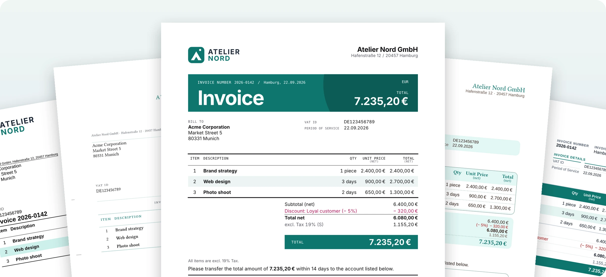
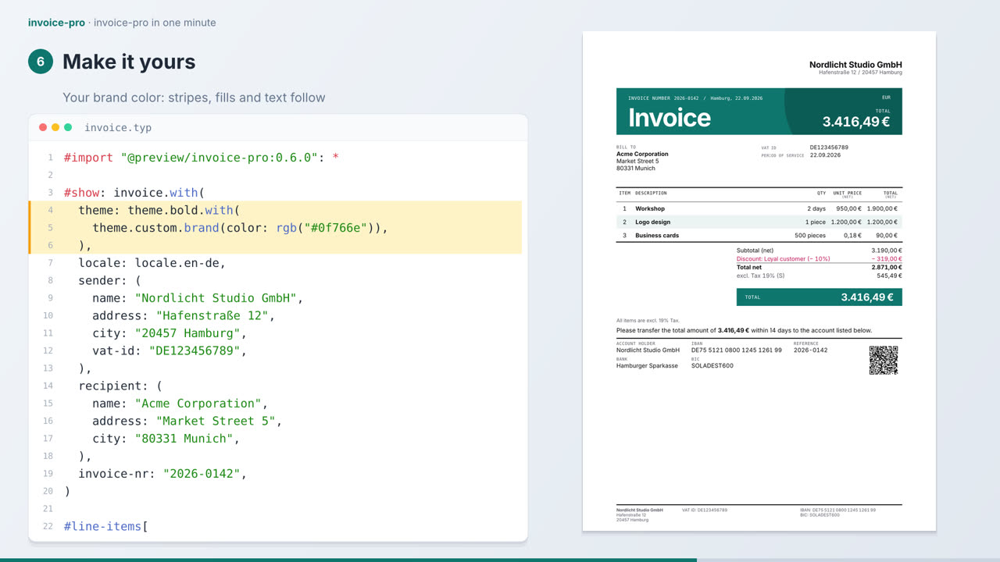
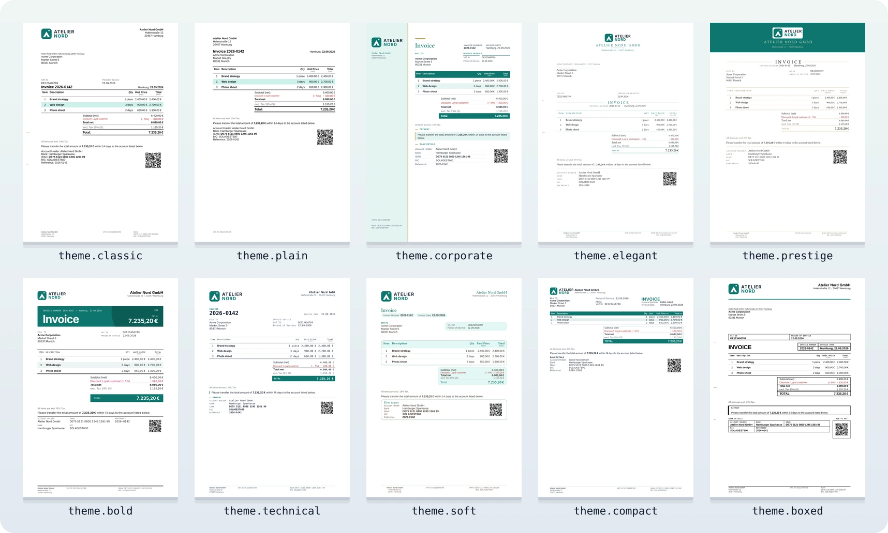
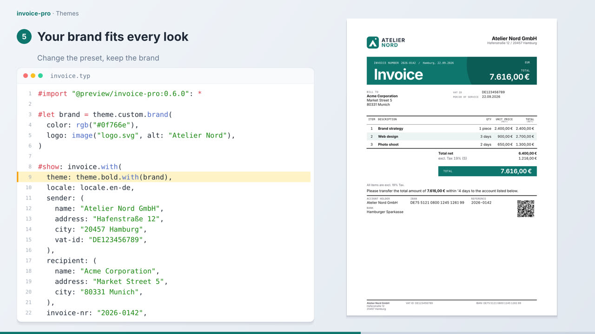
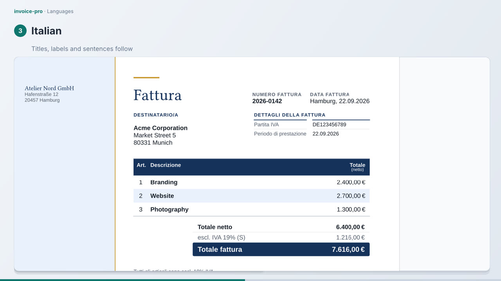
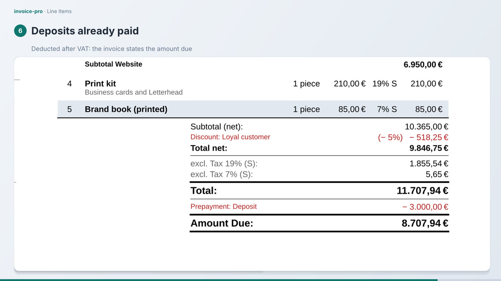
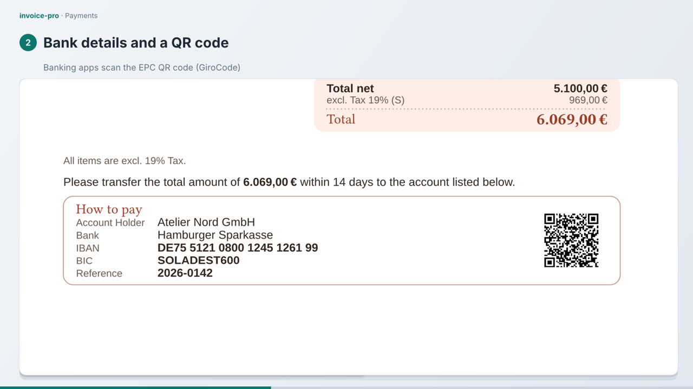
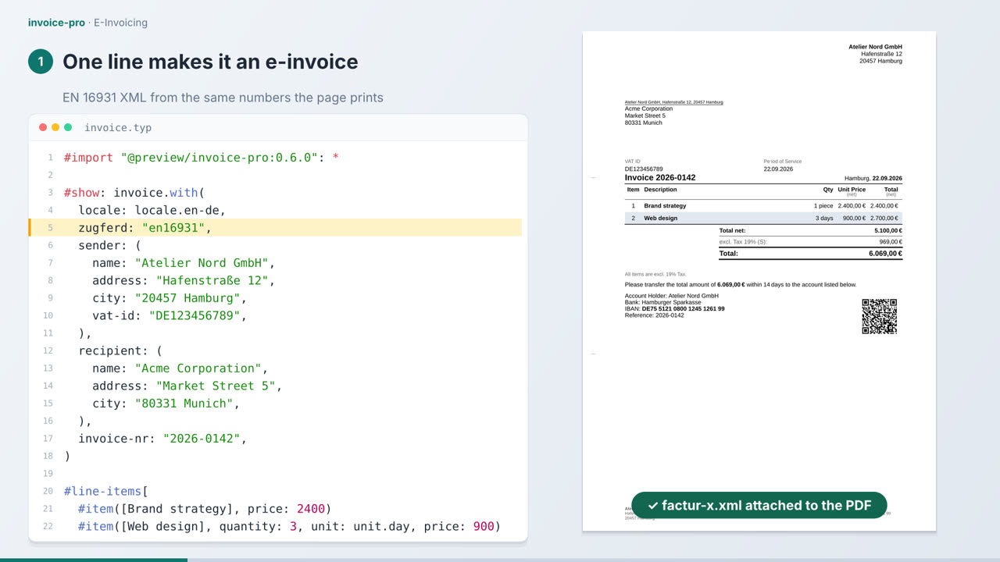

<!-- GitHub shows this README. The package README for Typst Universe is /README.md, with the markup Typst Universe renders: keep both in step. -->

<p align="center">
  
</p>

<h1 align="center">invoice-pro</h1>

<p align="center">
  <strong>Professional invoices in Typst.</strong><br>
  Calculated, compliant and e-invoice ready, from a few lines of code.
</p>

<p align="center">
  <a href="https://typst.app/universe/package/invoice-pro">Typst Universe</a> ·
  <a href="https://leonieziechmann.github.io/invoice-pro/">Documentation</a> ·
  <a href="https://leonieziechmann.github.io/invoice-pro/themes">Themes</a> ·
  <a href="https://leonieziechmann.github.io/invoice-pro/e-invoicing">E-Invoicing</a>
</p>

---

## See It in One Minute

<a href="https://leonieziechmann.github.io/invoice-pro/"></a>

<p align="center"><sub>▶ Items, a discount, payment, two themes, a brand color, a language and the e-invoice, each in a line or two. The video plays in the documentation.</sub></p>

## Highlights

<table>
<tr>
<td width="50%" valign="top">

### 🎨 Ten themes

From a DIN 5008 business letter to a poster look. Your brand color and logo in one line, on page layouts for the window envelopes of several countries.

</td>
<td width="50%" valign="top">

### 🌍 Five languages

German, English, French, Italian and Spanish, with the number formats, VAT rates and invoicing rules of six countries.

</td>
</tr>
<tr>
<td valign="top">

### 🧮 Calculated for you

Groups with subtotals, bundles, discounts, several VAT rates and prepayments: every total is computed for you.

</td>
<td valign="top">

### 💶 Paid faster

An EPC QR code for banking apps, cash discounts, SEPA direct debit and card payments.

</td>
</tr>
<tr>
<td valign="top">

### 🧾 E-invoice included

ZUGFeRD / Factur-X and XRechnung, made from the numbers the page prints and checked against EN 16931 while you write (experimental).

</td>
<td valign="top">

### ✅ Nothing missing

A draft marks missing invoice data and lists it with its legal basis; `validation: "strict"` stops the build instead.

</td>
</tr>
</table>

## Ten Looks, One Line

<p align="center">
  
</p>

```typst
#show: invoice.with(
  theme: theme.bold.with(theme.custom.brand(
    color: rgb("#0f766e"),
    logo: image("logo.svg", alt: "Atelier Nord"),
  )),
  // sender: .., recipient: .., invoice-nr: ..
)
```

Without a `theme`, an invoice uses `theme.classic`. Each look has a page with a sample and a quick start in the [documentation](https://leonieziechmann.github.io/invoice-pro/themes).

## Quick Start

Start a project from the template:

```bash
typst init @preview/invoice-pro
```

or write the invoice yourself:

```typst
#import "@preview/invoice-pro:0.6.0": *

#show: invoice.with(
  locale: locale.en-de,
  sender: (
    name: "Atelier Nord GmbH",
    address: "Hafenstraße 12",
    city: "20457 Hamburg",
    vat-id: "DE123456789",
  ),
  recipient: (
    name: "Acme Corporation",
    address: "Market Street 5",
    city: "80331 Munich",
  ),
  invoice-nr: "2026-0142",
)

#line-items[
  #item([Brand strategy], price: 2400)
  #item([Web design], quantity: 3, unit: unit.day, price: 900)
  #discount([Loyal customer], amount: 5%)
]

#payment-terms(days: 14)
#bank-details(
  bank: "Hamburger Sparkasse",
  iban: "DE75512108001245126199",
  bic: "SOLADEST600",
)
```

## Learn More

<table>
<tr>
<td width="33%" align="center"><a href="https://leonieziechmann.github.io/invoice-pro/themes"></a><br><b>Themes</b></td>
<td width="33%" align="center"><a href="https://leonieziechmann.github.io/invoice-pro/api-reference/locale"></a><br><b>Languages</b></td>
<td width="33%" align="center"><a href="https://leonieziechmann.github.io/invoice-pro/api-reference/line-items"></a><br><b>Line items</b></td>
</tr>
<tr>
<td align="center"><a href="https://leonieziechmann.github.io/invoice-pro/api-reference/components"></a><br><b>Payments</b></td>
<td align="center"><a href="https://leonieziechmann.github.io/invoice-pro/e-invoicing"></a><br><b>E-invoicing</b></td>
<td align="center" valign="middle"><a href="https://leonieziechmann.github.io/invoice-pro/">All guides and<br>the API reference →</a></td>
</tr>
</table>

## Status

The data model (`line-items`, `item`, `group`, `bundle`) is stable. The theme API is stable since v0.6.0: `theme.classic`, `theme.plain`, the tokens, the layouts and the part names are frozen; the other presets may still be refined. The locale API may still change. E-invoicing is experimental: Typst cannot write the Factur-X XMP metadata yet, so PDF validators reject the PDF although its XML is valid ([workaround](https://leonieziechmann.github.io/invoice-pro/e-invoicing/limitations#factur-x-xmp-metadata)).

## Development

The repository is a Nix flake: `nix develop` (or `direnv allow`) provides Typst, the formatters and a local package registry, and `check-pr` runs every check of a pull request. To try the latest version without installing anything:

```bash
nix run github:leonieziechmann/invoice-pro -- my-invoice.typ
```

The showcase videos and the images of this README are rendered from the code of the repository (`scripts/showcase-videos`, `scripts/readme-images`). Ideas and bug reports are welcome as [issues](https://github.com/leonieziechmann/invoice-pro/issues).

## Credits

invoice-pro uses [sepay](https://typst.app/universe/package/sepay) for the EPC QR code (with [ibanator](https://typst.app/universe/package/ibanator) for the IBAN check) and [loom](https://typst.app/universe/package/loom) for reactive rendering. Thanks to [classy-german-invoice](https://github.com/erictapen/typst-invoice) by Kerstin Humm, which inspired the template and the EPC QR code, to [Michael Fuchs (theexiile1305)](https://github.com/theexiile1305), who contributed the ZUGFeRD implementation, and to [letter-pro](https://typst.app/universe/package/letter-pro), which drew the DIN 5008 page up to v0.5.

## License

MIT
